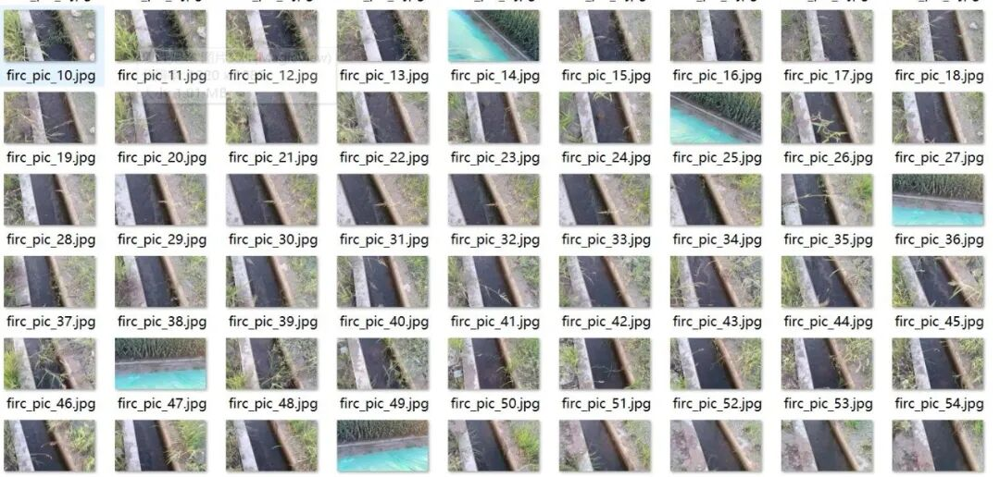
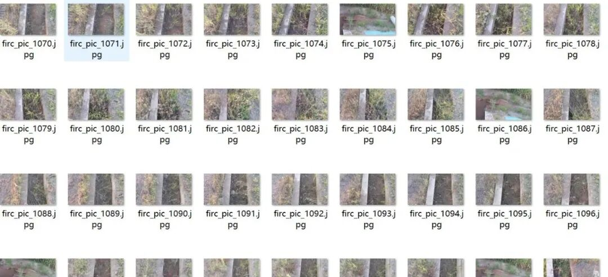
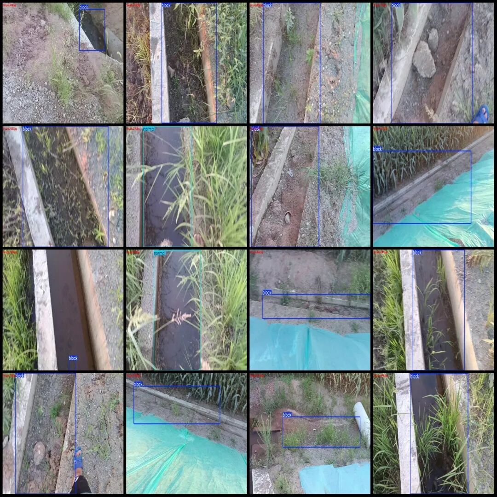
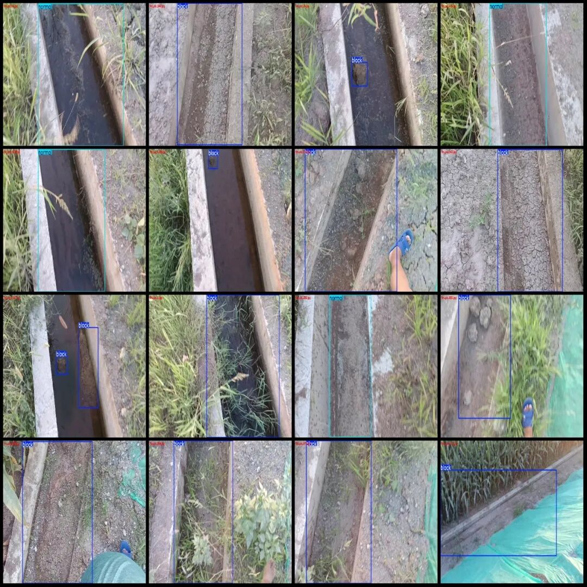

# Dataset for Roadside Slope Drainage Pond Obstruction and Mud Accumulation Detection from Drone Perspective in VOC+YOLO format with 1488 images in 2 categories

Dataset format: Pascal VOC format + YOLO format (txt file without split path, only containing jpg images and corresponding VOC format xml files and yolo format txt files)

Number of images (number of jpg files): 1488

Number of annotations (number of xml files): 1488

Number of annotations (number of txt files): 1488

Labeling category count: 2

Label category names (note that the order of categories in the Yolo format does not correspond to this, but is based on the classes.txt file in the labels folder): ["block", "normal"]

Number of boxes labeled in each category:

Block (blockage/stagnation) Frame Count = 1328

Normal (normal) box count = 295

Total frame count: 1623

Number of images per category:

Block ownership count = 1193

Normal occupancy count = 295

Image resolution: 1920x1080

Using labelImg:

Drone: DJI MAVIC 3

Collection height: 2-3m

Collection angle: 60~90°

Annotation rules: Draw a rectangle around the category.

Important Notice: The dataset does not have separate training, validation, and test sets; you need to partition them yourself.

Special : This dataset does not guarantee the accuracy of the trained models or weight files.

Image Preview:

Annotation example:

## Payment

Here is a pay link on Stripe ( https://buy.stripe.com/3cs8yP7sY87d0vu9AB ). Please contact me lonlonago@foxmail.com after funding $89, and I will send you a complete data files , thank you!

